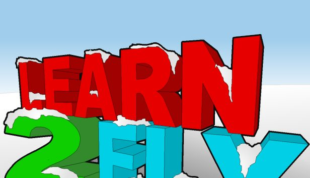

# Learn to Fly 2: source code

ActionScript 2 source for Learn to Fly 2 (2011), from the Flash project last saved in 2017, version 1.14. Most of the code was on the main timeline. The rest was on library symbol timelines, including frame scripts that set up button and movie clip behavior.

## Mechanics

The guides trace a flight from launch through gliding, boosting, and obstacle hits. They also cover the equipment stats and how scoring and progression vary by mode.

1. [Flight mechanics and scoring](docs/mechanics.md)
2. [Equipment and cash upgrades](docs/equipment.md)
3. [Modes and progression](docs/progression.md)

## Artwork renders

[Preview](docs/art-renders/preview.png) · [Asset manifest](docs/art-renders/manifest.csv). The full pack contains transparent 256 × 256 and 1024 × 1024 PNGs in `learn-to-fly-2-art-renders.zip` for [Releases](../../releases).

## What's here

This release is for reading the source. The game lived inside a Flash project file, with its code spread over the frames of its timelines, and the original art and sound files aren't included.

`scripts/` holds the exported game code:

1. `Main timeline.as`: the code on the game's main timeline.
2. `Library/`: one file per library symbol that has code, in the same folders as the project's library.

Each block starts with a comment saying where it sits, for example `// ---- layer "Control", frame 4`, or the instance it's attached to for `on (...)` and `onClipEvent (...)` code.

## License

The [LBG-NCNC License v1.0](LICENSE.md) covers Light Bringer Games' source code in this repository.

You can read, use, change, and share the code for noncommercial purposes, including by forking it on GitHub. When sharing, credit Light Bringer Games and keep the license and copyright notices. Get written permission before distributing or hosting a product based on the code that competes with or undercuts a Light Bringer Games product or service, even if it's free. The full license governs.

Light Bringer Games reserves its rights in the game's name, art, and sound. Third-party files have their own licenses.
